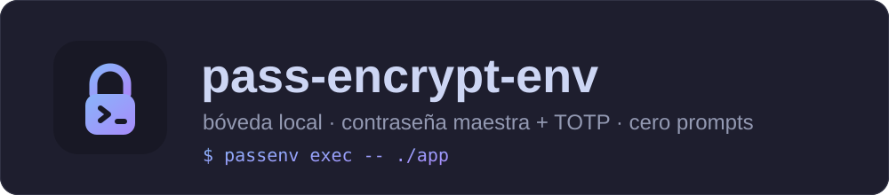
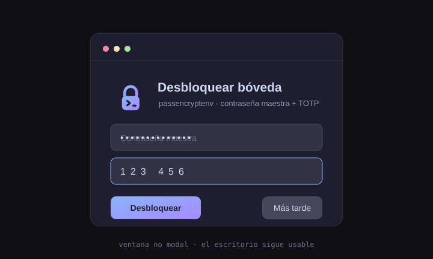

<div align="center">



<br>

[](https://github.com/yosoyignicion/pass-encrypt-env/actions/workflows/ci.yml)
[](#desarrollo)
[](LICENSE)
[](#fundamentos-de-seguridad)
[](#fundamentos-de-seguridad)
[](SECURITY.md)

<a href="#-español">🇪🇸 Español</a> &nbsp;·&nbsp; <a href="#-english">🇬🇧 English</a>

</div>

---

<a id="-español"></a>

## 🇪🇸 Español

**Bóveda local de secretos con contraseña maestra + TOTP y agente de sesión sin prompts.**
Cifra tus claves API y credenciales en tu equipo y las sirve a tus apps durante toda la
sesión tras **un único desbloqueo** al iniciar sesión. Privado, sin nube y sin telemetría.

### Cómo funciona

```
login ──► autostart lanza  passenv-agent
              │
              ▼   (no bloquea el escritorio)
        ┌───────────────────────────────┐
        │  Desbloquear bóveda           │   pop-up GTK3 no modal
        │  maestra  [•••••]             │   5 s tras iniciar sesión
        │  TOTP     [123456]            │
        └───────────────────────────────┘
              │  master + TOTP correctos
              ▼
        bóveda descifrada en RAM (mlock, sin core dumps)
              │
   apps ──────┴────► passenv exec -- ./app   (cero prompts)
```

El agente escucha en un **socket Unix** en `$XDG_RUNTIME_DIR/passenv/`, con permisos
`0600` y validación de UID (`SO_PEERCRED`): solo procesos de tu usuario acceden.



### Funcionalidades

- 🔐 **Bóveda cifrada** `vault.enc` — Argon2id + AES‑256‑GCM.
- 📱 **Segundo factor TOTP** (RFC 6238) — cualquier app de autenticación (QR/URI).
- 🧠 **Agente de sesión** — claves en RAM, nunca en claro en disco.
- 🪟 **Pop-up no modal** — el escritorio sigue usable mientras espera.
- 🚀 **Cero-prompt** — `passenv exec` / `passenv-load` inyectan el entorno sin volver a pedir nada.
- ♻️ **Clave de recuperación** — 256 bits Base32 con checksum (a prueba de erratas).
- 🧩 **CLI completa** — `init`, `set/get/list/rm`, `export`, `exec`, `change-master`, `backup`, `restore`.
- 🐧 **Instalación flexible** — autostart `.desktop` o `systemd --user`.

### Fundamentos de seguridad

- **KDF Argon2id** (64 MiB, 3 pasadas, 4 lanes) → resistente a GPU/ASIC.
- **AEAD AES‑256‑GCM** → confidencialidad **e integridad** (detecta manipulación).
- **Doble envoltura de la DEK**:
  `K1 = Argon2id(master)` · `K2 = HKDF(K1 ‖ totp_secret)` abre la DEK ·
  `K3 = HKDF(recovery_key)` guarda una copia para recuperación.
- **El secreto TOTP va cifrado**; sin TOTP correcto no se obtiene la DEK.
- **Endurecimiento del agente**: `PR_SET_DUMPABLE=0` (anti‑ptrace), sin core dumps,
  `mlockall` best‑effort, socket `0600`.

### Instalación

```bash
sudo apt install python3-gi python3-cryptography python3-click python3-qrcode libsecret-tools
git clone https://github.com/yosoyignicion/pass-encrypt-env
cd pass-encrypt-env
./install.sh            # autostart .desktop  (o: ./install.sh --systemd)
passenv init            # crea bóveda + TOTP + clave de recuperación
```

Guarda el **secreto TOTP** en tu app de autenticación y la **clave de recuperación
offline** (se muestra una sola vez). Cierra y abre sesión: aparecerá el pop-up.

### Uso

```bash
passenv status                 # estado del agente y de la bóveda
passenv lock                   # borra las claves de la memoria
passenv set OPENAI_API_KEY     # guarda (valor oculto)
passenv get OPENAI_API_KEY
passenv exec -- ./mi-app       # ejecuta con los secretos en el entorno
eval "$(passenv export)"       # inyecta en la shell actual
passenv change-master          # rota la contraseña maestra
passenv backup ~/nube/vault.enc
```

### Qué protege (y qué no)

| Amenaza | ¿Mitigado? |
|---|---|
| Robo offline de `vault.enc` | ✅ sin master+TOTP no hay datos |
| Manipulación del fichero | ✅ AEAD detecta la alteración |
| Alguien sin tu TOTP | ✅ segundo factor obligatorio |
| Pérdida de master/TOTP | ✅ clave de recuperación |
| Proceso del **mismo UID** con la bóveda abierta | ❌ techo del diseño cero‑prompt |
| `root` / malware ya dentro | ❌ fuera de alcance |

Detalle completo en [`docs/THREAT_MODEL.md`](docs/THREAT_MODEL.md).

### Comparativa

| | Cifrado en reposo | 2FA | Cero‑prompt de sesión | Local, sin nube |
|---|:--:|:--:|:--:|:--:|
| Variables de entorno / `.env` | ❌ | ❌ | — | ✅ |
| `secret-tool` / keyring | ✅ (clave de login) | ❌ | ✅ | ✅ |
| **pass-encrypt-env** | ✅ (Argon2id) | ✅ | ✅ | ✅ |

### Desarrollo

```bash
./scripts/ci.sh          # ruff + bandit + pytest
./scripts/smoke.sh       # arranque headless del agente + IPC
```

### Enlaces

[Guía de uso](docs/GUIA_USO.md) · [Modelo de amenazas](docs/THREAT_MODEL.md) ·
[Roadmap](docs/ROADMAP.md) · [Changelog](CHANGELOG.md) · [Contribuir](CONTRIBUTING.md) · [Seguridad](SECURITY.md)

MIT © [yosoyignicion](https://github.com/yosoyignicion)

---

<a id="-english"></a>

## 🇬🇧 English

**Local secrets vault with a master password + TOTP and a prompt‑less session agent.**
It encrypts your API keys and credentials on your machine and serves them to your apps
for the whole session after a **single unlock** at login. Private, no cloud, no telemetry.

### How it works

```
login ──► autostart starts  passenv-agent
              │
              ▼   (does not block your desktop)
        ┌───────────────────────────────┐
        │  Unlock vault                 │   non-modal GTK3 pop-up
        │  master  [•••••]              │   5 s after login
        │  TOTP    [123456]             │
        └───────────────────────────────┘
              │  correct master + TOTP
              ▼
        vault decrypted in RAM (mlock, no core dumps)
              │
   apps ──────┴────► passenv exec -- ./app   (zero prompts)
```

The agent listens on a **Unix socket** in `$XDG_RUNTIME_DIR/passenv/`, mode `0600`
with UID validation (`SO_PEERCRED`): only your own processes can talk to it.

### Features

- 🔐 **Encrypted vault** `vault.enc` — Argon2id + AES‑256‑GCM.
- 📱 **TOTP second factor** (RFC 6238) — any authenticator app (QR/URI).
- 🧠 **Session agent** — secrets in RAM, never in cleartext on disk.
- 🪟 **Non-modal pop-up** — the desktop stays usable while it waits.
- 🚀 **Zero-prompt** — `passenv exec` / `passenv-load` inject the environment, no re-typing.
- ♻️ **Recovery key** — 256-bit Base32 with checksum (typo-resistant).
- 🧩 **Full CLI** — `init`, `set/get/list/rm`, `export`, `exec`, `change-master`, `backup`, `restore`.
- 🐧 **Flexible install** — `.desktop` autostart or `systemd --user`.

### Security foundations

- **Argon2id KDF** (64 MiB, 3 passes, 4 lanes) → GPU/ASIC-resistant.
- **AES‑256‑GCM AEAD** → confidentiality **and** integrity (tamper-evident).
- **Two-layer DEK wrapping**:
  `K1 = Argon2id(master)` · `K2 = HKDF(K1 ‖ totp_secret)` unwraps the DEK ·
  `K3 = HKDF(recovery_key)` keeps a recovery copy.
- The **TOTP secret is encrypted**; without a valid TOTP you don't get the DEK.
- **Agent hardening**: `PR_SET_DUMPABLE=0` (anti-ptrace), no core dumps,
  best-effort `mlockall`, `0600` socket.

### Install

```bash
sudo apt install python3-gi python3-cryptography python3-click python3-qrcode libsecret-tools
git clone https://github.com/yosoyignicion/pass-encrypt-env
cd pass-encrypt-env
./install.sh            # .desktop autostart  (or: ./install.sh --systemd)
passenv init            # create vault + TOTP + recovery key
```

Store the **TOTP secret** in your authenticator and keep the **recovery key offline**
(shown once). Log out and back in: the pop-up appears.

### Usage

```bash
passenv status                 # agent + vault state
passenv lock                   # wipe secrets from memory
passenv set OPENAI_API_KEY     # store (hidden value)
passenv get OPENAI_API_KEY
passenv exec -- ./my-app       # run with secrets in the environment
eval "$(passenv export)"       # inject into the current shell
passenv change-master          # rotate the master password
passenv backup ~/cloud/vault.enc
```

### What it protects (and what it doesn't)

| Threat | Mitigated? |
|---|---|
| Offline theft of `vault.enc` | ✅ no data without master+TOTP |
| File tampering | ✅ AEAD detects changes |
| Someone without your TOTP | ✅ mandatory second factor |
| Lost master/TOTP | ✅ recovery key |
| A **same-UID** process while the vault is open | ❌ the zero-prompt design ceiling |
| `root` / malware already inside | ❌ out of scope |

Full detail in [`docs/THREAT_MODEL.md`](docs/THREAT_MODEL.md).

### Comparison

| | Encryption at rest | 2FA | Prompt-less session | Local, no cloud |
|---|:--:|:--:|:--:|:--:|
| Environment vars / `.env` | ❌ | ❌ | — | ✅ |
| `secret-tool` / keyring | ✅ (login key) | ❌ | ✅ | ✅ |
| **pass-encrypt-env** | ✅ (Argon2id) | ✅ | ✅ | ✅ |

### Development

```bash
./scripts/ci.sh          # ruff + bandit + pytest
./scripts/smoke.sh       # headless agent + IPC smoke
```

### Links

[User guide](docs/GUIA_USO.md) · [Threat model](docs/THREAT_MODEL.md) ·
[Roadmap](docs/ROADMAP.md) · [Changelog](CHANGELOG.md) · [Contributing](CONTRIBUTING.md) · [Security](SECURITY.md)

MIT © [yosoyignicion](https://github.com/yosoyignicion)
